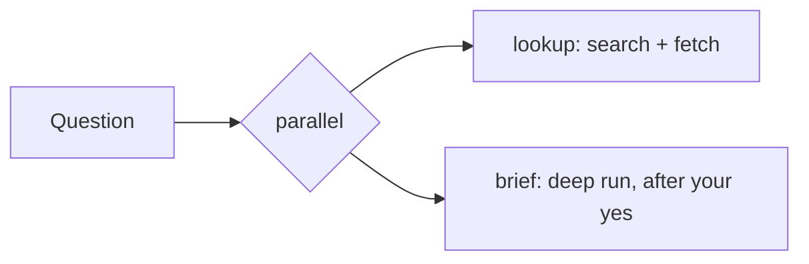
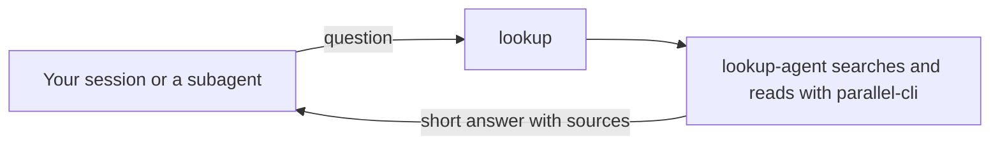
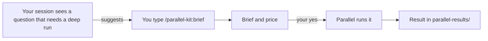

# parallel-kit

**[Parallel](https://parallel.ai), set up for agents.**

A Claude Code plugin that puts the best of Parallel's web tools in one place, so your sessions and subagents use the right one at the right time without you thinking about it.

> Not affiliated with Parallel Web Systems. This kit is built on their [`parallel-cli`](https://docs.parallel.ai/integrations/cli) and their own [agent skills](https://github.com/parallel-web/parallel-agent-skills), and keeps their texts word for word wherever it can.

## Why I built this

Parallel is the best web platform for agents I've used. It has already solved most of what makes agents bad at the web:

| Problem | What Parallel ships |
| --- | --- |
| Search results are links, not answers | Search returns ranked excerpts written to be answered from directly |
| Reading a page means pulling the whole page | Extract returns the parts that matter, from articles, PDFs and JavaScript-heavy sites |
| A broad question needs a real report | [Deep research](https://github.com/parallel-web/parallel-agent-skills/blob/main/skills/parallel-deep-research/SKILL.md): a cited report, from cents to a few dollars by processor |
| "Find every X that Y" | [FindAll](https://github.com/parallel-web/parallel-agent-skills/blob/main/skills/parallel-findall/SKILL.md): a structured list of matching entities, with evidence |
| A list that needs facts filled in | [Enrichment](https://github.com/parallel-web/parallel-agent-skills/blob/main/skills/parallel-data-enrichment/SKILL.md): web-sourced columns added to your rows |

The problem isn't the tools. It's knowing which one to use, and when.

### #1: It's hard to know what to use

**The Problem**: Parallel's [plugin](https://github.com/parallel-web/parallel-agent-skills) is all or nothing: fifteen skills, an agent and an MCP server. How to use each product lives in its own skill. And Parallel really has two sides:

| | Quick lookups | Deep runs |
| --- | --- | --- |
| What | Search the web, read a page | Deep research, FindAll, enrichment |
| Gives you | Facts, docs, a page's content | A cited report, every X that Y, new columns for your rows |
| Costs | Fractions of a cent | Cents to a few dollars |
| Takes | Seconds | Minutes |
| In this kit, started by | Any session or subagent | Only you, after a brief |

A session left to itself sticks to the first side and forgets the second exists, or reaches for the second when a search would do.

**The Fix**: one router, [`parallel`](./skills/parallel/SKILL.md), that the main session reaches for when a question may need the web. It decides between a lookup and a paid run, and points to what each costs.

### #2: Going deep should be a conversation

**The Problem**: a deep research or FindAll run is only as good as its brief, and it costs real money. An agent that starts one on its own guesses the question, the tier and the output, and you find out afterwards.

**The Fix**: [`brief`](./skills/brief/SKILL.md). When a question needs a deep run, the session writes the brief with you: what you need and why, the exact input Parallel will get, the processor and its price. Nothing runs until you say yes. The run polls in the background, and the result lands in `parallel-results/` in your repo, not in `/tmp`.

**Follow-ups**, as Parallel designed them: a deep research run returns an `interaction_id`, and a follow-up ("drill deeper into X") reuses that run's context, often on a cheaper processor. Enrichment can start from an earlier research run's context, and a FindAll run can be extended when you want more matches. Each follow-up is a new paid run, so it gets its own brief and your yes. A deep research run's file in `parallel-results/` keeps its `interaction_id`, and a FindAll run's file keeps its `findall_id`, so a later session can pick them up there.

### #3: Subagents should search too, but never spend

**The Problem**: the agents doing the work need the web as much as you do. But `parallel-cli` is signed in for the whole machine, so any subagent could start a paid run, and Parallel's spend limits only notify you; they don't stop the run.

**The Fix**: two parts.

- [`lookup`](./skills/lookup/SKILL.md) gives every session and subagent Parallel's search and fetch. It runs in its own agent, [`lookup-agent`](./agents/lookup-agent.md), which runs `parallel-cli` and hands back a short answer with its sources and the path of the saved results, in `/tmp/parallel-<name>.json`. The pages it read never fill your context.
- A [guard](./hooks/parallel_subagent_guard.py) on every Bash call: a subagent may run `parallel-cli` search, extract and fetch, and nothing that spends. The main session is never blocked.

## How it fits together



### A lookup: the same from your session or any subagent



### A deep run: only from your session, only when you ask



A subagent can't start a deep run. If its lookup finds the question needs one, it says so, and your session takes it from there. The guard refuses any paid `parallel-cli` call a subagent tries.

### Harder questions, without a paid run

The lookup agent searches in Parallel's default `basic` mode and switches to `advanced` (multi-step, agentic search) when a question needs it. It's still a lookup, priced in fractions of a cent, not a paid run.

### What I kept from Parallel, and what I left out

| Parallel's skill | In the kit |
| --- | --- |
| `parallel-deep-research`, `parallel-findall`, `parallel-data-enrichment`, `status`, `result` | Kept word for word, as the references `brief` follows |
| Task API guides and the pricing page | Kept word for word, minus the docs site's navigation note at the top of each page |
| `parallel-web-search`, `parallel-web-extract` | Merged into `lookup` and trimmed |
| `parallel-subagent` | Kept as `lookup-agent`, nearly word for word |
| Parallel's MCP server | Left out: in a terminal agent the CLI costs far fewer context tokens, as Parallel's docs say |
| `parallel-cli-setup` | Replaced by `setup` |
| `parallel-monitor`, `parallel-memory`, `parallel-mcp-setup`, `parallel-search-setup`, `parallel-search-evaluation`, `parallel-api`, `migrate-to-parallel` | Left out: for building on Parallel, not for using it in a session |

## Installation

You need Claude Code v2.1.299 or later, a [Parallel account](https://platform.parallel.ai), and `python3`.

### 1. Get the plugin

```bash
claude plugin marketplace add tdarenkov/claude-plugins
claude plugin install parallel-kit@tdarenkov
```

### 2. Run `/parallel-kit:setup`

In a Claude Code session, once per machine. It will:

- Offer to remove Parallel's own plugin, which competes with `lookup`
- Install and sign in `parallel-cli`, if needed
- Offer to fix your named agents, so they can use the lookup (below)
- Offer to turn on auto-update
- Run one real lookup to show it works

Run it again any time; it redoes only what failed.

**Why named agents need fixing:** a skill that runs in its own agent only gets the tools its caller has. A subagent with a fixed `tools:` list can use `lookup` only if that list includes `Skill`, so setup offers to add it.

### 3. That's it.

## Updating

Setup offers to turn on auto-update (or turn it on yourself: `/plugin`, **Marketplaces**, `tdarenkov`). Updates then arrive in the background and load on `/reload-plugins` or the next session.

Without it, update by hand:

```bash
claude plugin update parallel-kit@tdarenkov
```

## Reference

**User-invoked**

- **[setup](./skills/setup/SKILL.md)**: set up the plugin on this machine, or check it again.
- **[brief](./skills/brief/SKILL.md)**: write, price and run a deep research, FindAll or enrichment run, after your yes.

**Model-invoked**

- **[parallel](./skills/parallel/SKILL.md)**: the router: a lookup or a paid run, and where the costs are. You can also type it.
- **[lookup](./skills/lookup/SKILL.md)**: every web search and page read, in its own agent, back as a short cited answer.

Issues are welcome. Changes: [CHANGELOG.md](CHANGELOG.md). Security problems: [SECURITY.md](SECURITY.md). License: [MIT](LICENSE).
